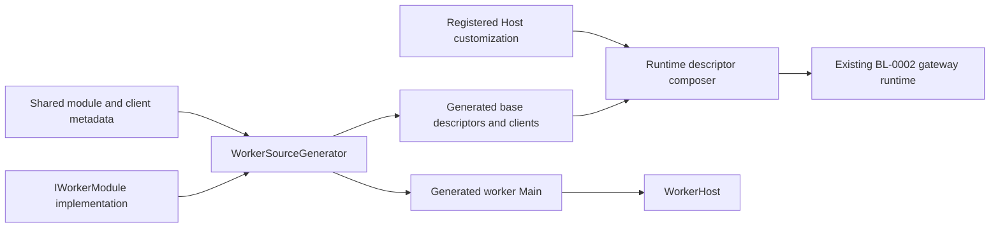
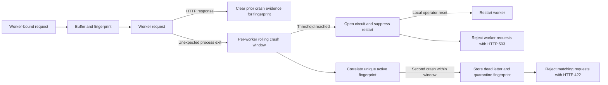

# Modular Monolith Unified Architecture

This document defines the consolidated architecture of the modular monolith system. It unifies the Linux and Windows operational models into a single, cohesive architecture where process isolation, inter-process communication (IPC), and lifecycle supervision are fully abstracted.

---

## 1. Architectural Vision & Fundamentals

The system architecture combines the operational simplicity of a **monolithic deployment** (single installer, unified lifecycle, single gateway entrypoint) with the fault-containment and resource governance of **isolated microservices**.

```
┌────────────────────────────────────────────────────────────────────────┐
│ TIER 1: HOST ORCHESTRATOR & EDGE GATEWAY                               │
│  ├── Gateway / Reverse Proxy (Unified HTTP Ingress over IPC)           │
│  ├── Operator API (separate loopback management listener)              │
│  ├── Module Process Supervisor & Lifecycle Watchdog                    │
│  ├── Edge Security Boundary (Authentication & Context Propagation)     │
│  └── Central Asynchronous Event Bus (System.Threading.Channels)        │
└──────────────────────────────────┬─────────────────────────────────────┘
                                   │ IPC Channel (UDS / Named Pipes / MMF)
                                   ▼
┌────────────────────────────────────────────────────────────────────────┐
│ TIER 2: WORKER RUNTIME & PROCESS ISOLATION                             │
│  ├── OS Resource Governance (cgroups v2 on Linux, Job Objects on Win)  │
│  ├── Anti-Orphan Process Guards (PR_SET_PDEATHSIG, KillOnJobClose)     │
│  └── Graceful Draining & Signal Handling (SIGTERM, Named Event)        │
└──────────────────────────────────┬─────────────────────────────────────┘
                                   │ Statically Linked Module Interface
                                   ▼
┌────────────────────────────────────────────────────────────────────────┐
│ TIER 3: DOMAIN LOGIC & WORKER ENDPOINTS                                │
│  ├── Pure Handlers & Minimal API Endpoints (IWorkerModule)             │
│  └── High-Performance Transport Serialization                          │
└────────────────────────────────────────────────────────────────────────┘
```

### Core Architecture Invariants
1. **Single Host Process / Public Gateway**: The Host is the only process exposed to public traffic. Operator management APIs use a separate loopback listener.
2. **OS-Level Isolation**: Modules run in dedicated child worker processes bounded by operating system kernel limits. A native memory leak, crash, or unhandled exception in one worker cannot bring down the Host or other workers.
3. **No Network Loopback for IPC**: Communication between Host and workers uses kernel IPC primitives (Unix Domain Sockets on Linux, Named Pipes on Windows, or shared memory).
4. **Deterministic Orphan Elimination**: If the Host process terminates abruptly (e.g., `SIGKILL`, crash, power loss), the kernel automatically cleans up all child worker processes without orphan state.
5. **Two-Phase Graceful Shutdown**: On stop, the Host drains public HTTP requests first, signals workers to drain internal work and checkpoint state, and then tears down process containers.

---

## 2. Platform Abstraction Architecture

All OS-specific features are abstracted through cross-platform contracts in `ModularMonolith.Abstractions`, resolved at runtime via `PlatformServices` (`ModularMonolith.Platform`):

```
                       ModularMonolith.Abstractions
                      ┌────────────────────────────┐
                      │ IJob, IJobFactory          │
                      │ IProcessGuard              │
                      │ IGracefulStopStrategy      │
                      │ IWorkerTransport           │
                      └──────────────┬─────────────┘
                                     │
                 ┌───────────────────┴───────────────────┐
                 ▼                                       ▼
       ModularMonolith.Linux                  ModularMonolith.Windows
  ┌─────────────────────────────┐        ┌─────────────────────────────┐
  │ CgroupJob (cgroup v2)       │        │ WindowsJob (Job Objects)    │
  │ LinuxProcessGuard (prctl)   │        │ WindowsProcessGuard (Win32) │
  │ SigTermStopStrategy         │        │ NamedEventStopStrategy      │
  │ UnixSocketTransport         │        │ NamedPipeTransport          │
  └─────────────────────────────┘        └─────────────────────────────┘
```

### Detailed Abstraction Matrix

| Concern | Abstraction | Linux Implementation | Windows Implementation | Portability Invariant |
|---|---|---|---|---|
| **Resource Governance** | `IJob` / `IJobFactory` | `CgroupJob` (cgroup v2 subtree) | `WindowsJob` (Win32 Job Object) | Platform-neutral `JobLimits` (`MemoryMaxBytes`, `MemoryHighBytes`, `CpuCores`, `MaxProcesses`). |
| **Memory Hard Cap** | `JobLimits.MemoryMaxBytes` | `memory.max` (triggers Linux OOM killer on worker) | `JOB_OBJECT_LIMIT_PROCESS_MEMORY` & `JOB_OBJECT_LIMIT_JOB_MEMORY` | Limits committed RAM per worker. |
| **Memory Soft Reclaim** | `JobLimits.MemoryHighBytes` | `memory.high` (synchronous page reclaim) | Ignored (Windows kernel has no soft reclaim threshold) | Reclaims cached pages under pressure. |
| **CPU Rate Throttling** | `JobLimits.CpuCores` | `cpu.max` (quota in 100ms period) | `JOB_OBJECT_CPU_RATE_CONTROL_ENABLE` + `HARD_CAP` | Restricts CPU percentage proportional to processor count. |
| **Thread / Process Cap** | `JobLimits.MaxProcesses` | `pids.max` (limits process & thread count) | `JOB_OBJECT_LIMIT_ACTIVE_PROCESS` (limits process count) | Prevents thread/fork exhaustion. |
| **Orphan Protection** | `IProcessGuard` | `LinuxProcessGuard` calling `prctl(PR_SET_PDEATHSIG, SIGKILL)` | Implicit via `JOB_OBJECT_LIMIT_KILL_ON_JOB_CLOSE` | Child terminates immediately if Host parent dies. |
| **Graceful Stop** | `IGracefulStopStrategy` | `SigTermStopStrategy` sending POSIX `SIGTERM` | `NamedEventStopStrategy` signaling Win32 named `EventWaitHandle` | Worker initiates `IHostApplicationLifetime.StopApplication()`. |
| **IPC Transport** | `IWorkerTransport` | `UnixSocketTransport` (UDS at `/run/.../*.sock` or temp dir) | `NamedPipeTransport` (`modular-monolith.<runId>.<module>`) | Local IPC with user-only file/pipe security (`0600`). |

---

## 3. Architectural Tiers & Specifications

### Tier 1: Host Orchestrator & Gateway Edge
The Host process serves as the sole public entry point, security boundary, and lifecycle supervisor for all workers.
* **Gateway Routing**: YARP routes declared worker paths over private UDS or Named Pipe transports. Worker readiness controls destination availability, and unavailable clusters return a problem-details HTTP 503 response. YARP forwarding has no added retries.
* **Gateway Security Context**: The Host replaces external internal-context headers with a short-lived HMAC-signed payload. Only configured `HttpContext.User` claim types are forwarded. Each Host run passes a 256-bit key to child workers through an environment variable.
* **Worker Lifecycle Supervisor (`WorkerManager`)**: Launches workers with allocated transport endpoints and resource limits, monitors child exit status, cleans up stale transport artifacts, and restarts failed processes with exponential backoff (1s to 30s).
* **Request Drain Gate (`RequestDrainTracker`)**: Tracks in-flight Host HTTP requests. During host termination, it rejects new ingress requests (HTTP 503) and ensures active requests complete before workers are stopped.
* **Operator Management Listener**: Binds to `127.0.0.1:5228` by default, separate from public listeners. It exposes circuit reset and dead-letter inspection routes without application authentication. A non-loopback bind requires deployment-level network access controls.

### Tier 2: Worker Runtime & Process Isolation
Each worker process executes within a sandboxed kernel container.
* **Resource Bounding**: Workers run under strict RAM and CPU caps to prevent noisy-neighbor degradation.
* **Clean Termination**: Workers listen for shutdown signals (`SIGTERM` on Linux, named `EventWaitHandle` on Windows), allow in-flight socket requests to drain, flush persistence layers (e.g., SQLite WAL checkpoints), remove transport sockets, and exit cleanly.

### Tier 3: Domain Modules & High-Performance IPC
Each module implements cohesive vertical domain logic:
* **Worker Side (`IWorkerModule`)**: Configures internal dependency injection (`ConfigureServicesAsync`) and registers endpoints (`MapEndpoints`).
* **Shared Declaration**: Defines stable module identity, proxy routes, client operations, and DTOs in a shared assembly.
* **Generated Wiring (`WorkerSourceGenerator`)**: Creates Host descriptors, typed clients, DI registration, and worker `Main` methods from compile-time metadata.
* **Host Customization**: An explicitly registered `IHostModuleCustomization` can add module-specific limits, worker arguments, or Host services. Runtime descriptor composition applies these customizations after generation. The generator does not inspect customization types or members.
* **Serialization & Contracts (`ModularMonolith.Contracts`)**: DTOs and explicit `JsonSerializerContext` metadata shared by Host and workers without reflection.



### Tier 4: Resilience & Circuit Breaking
Protects the Host from cascading failures and crash-looping workers:
* **Drain & Timeout**: Graceful shutdown bounded by `Workers:ShutdownGracePeriod` (default 10s) with hard termination fallback.
* **Exponential Backoff**: Exited workers restart with backoff delays capped at 30 seconds; stable runs (>1 minute) reset backoff to 1 second.
* **Worker Circuit Breaker**: `Workers:CircuitBreaker:MaxCrashes` defaults to 3 and `Workers:CircuitBreaker:WindowSeconds` defaults to 120. Each worker tracks unexpected exits independently. It enters `Open` at the threshold and does not restart until `POST /modules/{name}/reset` succeeds.
* **Poison-Payload Quarantine**: The Host hashes each worker-bound request using its method, canonical path and query, and raw body. It buffers at most 1 MiB per request. A fingerprint is attributed to a crash only when it is the unique active fingerprint for that worker. Two correlated crashes within 120 seconds quarantine it. Matching requests receive HTTP 422; oversized requests receive HTTP 413.
* **Dead-Letter Storage**: Quarantined request metadata and raw bodies stay in memory, up to 100 records and 10 MiB of body data. FIFO eviction removes both the record and its quarantine. Host restart clears the store; circuit reset does not.



---

## 4. Architectural Glossary

| Term | Definition in this System |
|---|---|
| **Host Orchestrator** | The parent ASP.NET Core process (`ModularMonolith.Host`) running as a daemon or service. It manages ingress traffic, routing, and child process lifecycles. |
| **Worker Process** | An independent operating system child process executing a compiled worker binary (e.g., `ModularMonolith.Worker.SvgRenderer`). |
| **Module** | A cohesive functional unit composed of shared metadata and contracts, a worker-side implementation (`IWorkerModule`), generated Host wiring, and optional Host hooks. |
| **Resource Container (`IJob`)** | A kernel-level governance container (`CgroupJob` on Linux, `WindowsJob` on Windows) enforcing memory, CPU, and process count limits on child processes. |
| **Process Guard (`IProcessGuard`)** | A kernel mechanism ensuring child worker processes are killed immediately if the parent Host process dies unexpectedly. |
| **Transport (`IWorkerTransport`)** | An IPC communication mechanism abstracting socket creation, Kestrel binding, HttpClient client handler configuration, and endpoint cleanup. |
| **Supervisor** | The Host background component (`WorkerManager`) that continuously supervises child worker processes, detects exits, and applies backoff restart logic. |
| **Request Drain Gate** | Middleware and synchronization tracker (`RequestDrainTracker`) in the Host that coordinates graceful shutdown between incoming web traffic and worker termination. |

---

## 5. Shipped Implementation vs. Target Backlog

| Capability / Component | Shipped Implementation (Today) | Target Architecture (Backlog) | Tracking Item |
|---|---|---|---|
| **Gateway Routing** | Generated descriptor and client registration feeding the BL-0002 YARP dynamic proxy; open circuits remove worker destinations and unavailable routes return HTTP 503 | Additional connection-pool controls | `BL-0002`, `BL-0003`, `BL-0005` |
| **Transport Resilience** | Typed worker clients retry safe methods only (two bounded jittered retries), with per-worker timeouts and lifecycle readiness gating; YARP has no added retries | Additional connection-pool controls | `BL-0001`, `BL-0005` |
| **Module Code Generation** | `WorkerSourceGenerator` emits Host wiring, typed clients, and worker entry points without runtime reflection | Additional metadata and client operation shapes as modules require them | `BL-0003` |
| **Build & Packaging** | Dynamic MSBuild batching of marked worker project references into framework-dependent or self-contained `workers/<ProjectName>` bundles | Extend the same bundle contract as new worker RIDs and publication modes are added | `BL-0004` |
| **Crash Loop Protection** | Exponential backoff plus per-worker rolling-window circuit breakers, poison-payload quarantine, and bounded in-memory dead-letter storage | — | `BL-0005` |
| **High-Throughput IPC** | Kestrel over UDS / Named Pipes with JSON | Shared Memory (MMF) ring buffer for sub-millisecond streaming | `BL-0006` |

---

## 6. Platform Deployment Appendices

### Appendix A: Linux (systemd & cgroups v2)
- **Service Configuration**: Shipped in `deploy/systemd/modular-monolith.service`. Runs under dedicated unprivileged account `modularmonolith`.
- **Cgroup Delegation**: Uses `Delegate=yes` and `Slice=modular-monolith.slice` to allow the Host to manage child worker cgroup subtrees under `/sys/fs/cgroup/`.
- **Signal Handling**: Systemd unit specifies `KillMode=mixed` and `TimeoutStopSec=30`, ensuring `SIGTERM` is delivered first to the Host orchestrator to run graceful draining.
- **Production Paths**: Sockets default to `/run/modular-monolith` (`RuntimeDirectory=modular-monolith`) and data to `/var/lib/modular-monolith` (`StateDirectory=modular-monolith`).

### Appendix B: Windows (Windows Services & Job Objects)
- **Service Configuration**: Host registers as Windows Service via `builder.Host.UseWindowsService(options => options.ServiceName = "ModularMonolith")`.
- **Service Management**: Controlled via elevated PowerShell scripts: `deploy/windows/install.ps1`, `deploy/windows/run.ps1`, and `deploy/windows/uninstall.ps1`.
- **Security & Accounts**: Runs under virtual service account `NT SERVICE\ModularMonolith` with restricted ACLs on `%ProgramFiles%\ModularMonolith` (Read/Execute) and `%ProgramData%\ModularMonolith` (Modify).
- **Restart Policy**: Configured via `sc.exe failure` to restart up to 3 times in 60 seconds upon unexpected service failure.
