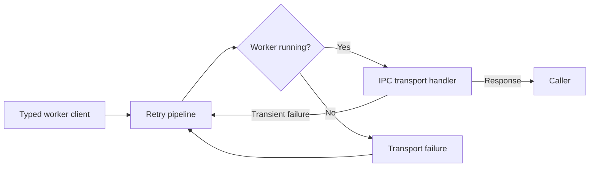

# Worker request resilience

The Host creates a named HTTP client for each module. The client uses the
module's allocated Unix Domain Socket or Named Pipe endpoint. The supervisor
reuses that endpoint when it restarts the worker. Before each transport
attempt, `WorkerReadinessHandler` checks `WorkerManager` and sends only when
the worker is `Running`.

The typed-client HTTP resilience pipeline retries only `GET`, `HEAD`,
`OPTIONS`, and `TRACE` requests. It allows at most two retries and uses
exponential backoff with jitter, starting at 100 ms and capped at 500 ms per
delay. It ignores `Retry-After`. The pipeline handles transient HTTP responses
and transport failures, including readiness failures. It does not guarantee
that a request survives a restart: retries can finish before the worker is
ready. Other methods, including `POST`, `PUT`, `PATCH`, and `DELETE`, are not
retried because an interrupted attempt may have executed.

YARP uses a separate forwarder client factory. It does not use this typed-client
retry pipeline, and the Host does not add retries to YARP forwarding.

`Workers:<Module>:TimeoutSeconds` sets the client request timeout. The
default is 10 seconds, and non-positive values are rejected. The Host maps
renderer transport failures and timeouts to HTTP 503 on the grid routes.
Cache failures instead log a warning and fall back to rendering or skip the
cache write. Caller cancellation is not treated as a worker timeout.

The Host owns the pooled worker transport handlers. It disposes them during
service-provider shutdown, releasing their IPC connections. The completed
[BL-0001](../backlog/bl-0001.md) item records the cross-platform test
evidence. Circuit breakers, poison-payload quarantine, and dead-letter
management are documented in the [architecture overview](./overview.md) and
[BL-0005](../backlog/bl-0005.md).
