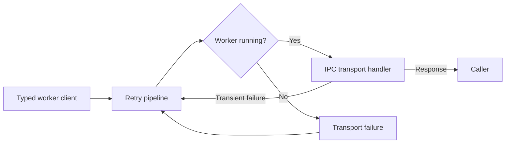

# Worker request resilience

The Host creates a named HTTP client for each module. The client uses the
module's allocated Unix Domain Socket or Named Pipe endpoint. The supervisor
reuses that endpoint when it restarts the worker. Before each transport
attempt, `WorkerReadinessHandler` checks `WorkerManager` and sends only when
the worker is `Running`.

The HTTP resilience pipeline allows at most two retries. It uses exponential
backoff with jitter, starting at 100 ms and capped at 500 ms per delay. It
ignores `Retry-After`. The pipeline handles transient HTTP responses and
transport failures, including readiness failures. It does not guarantee that
a request survives a restart: retries can finish before the worker is ready.
It can retry POST and PUT requests, so a failed attempt may have already
executed. Callers must account for possible duplicate execution.

`Workers:<Module>:TimeoutSeconds` sets the client request timeout. The
default is 10 seconds, and non-positive values are rejected. The Host maps
renderer transport failures and timeouts to HTTP 503 on the grid routes.
Cache failures instead log a warning and fall back to rendering or skip the
cache write. Caller cancellation is not treated as a worker timeout.

The Host owns the pooled worker transport handlers. It disposes them during
service-provider shutdown, releasing their IPC connections. The completed
[BL-0001](../backlog/bl-0001.md) item records the cross-platform test
evidence. Circuit breaking remains future work.
