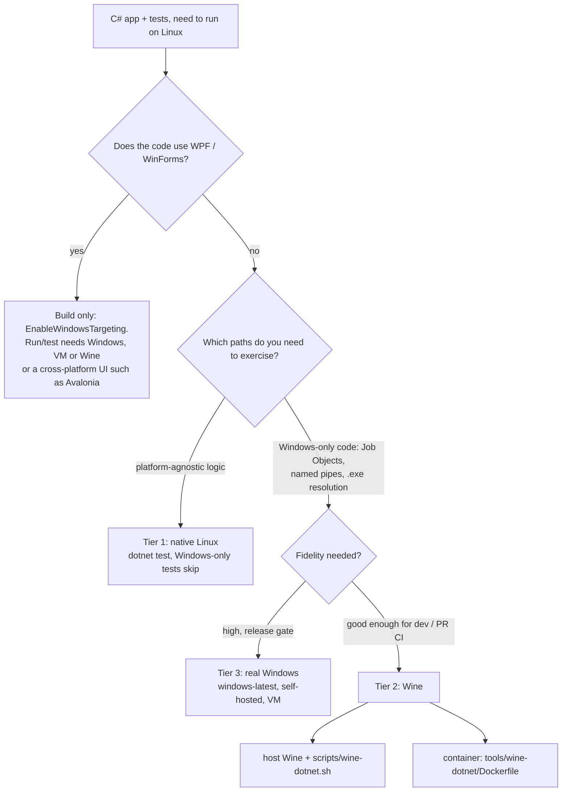
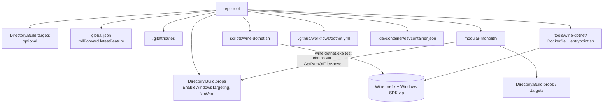

# Running a C# "Windows" application and its tests on Linux — options for the whole `janovrom/playground` repository

*Research date: 2026-10-12 · Host used for empirical checks: Fedora 44, .NET SDK 10.0.112 (+ 9.0.121), Wine 11.0 (Staging, wow64), rootless Podman 5.8*

---

## Executive summary

For code that uses only platform-agnostic .NET APIs, **no special tooling is needed**. A plain `net10.0` project, or even a `net10.0-windows` project that does not use WPF/WinForms, builds, runs and tests on Linux with the stock SDK, and `OperatingSystem.IsWindows()` simply returns `false`[^5]. In this repo that path already works: `dotnet test ModularMonolith.slnx` on Linux gives **92 passed / 9 skipped / 0 failed**. The 9 skipped tests are the `[WindowsFact]` tests that exercise real Win32 code (Job Objects, named pipes, apphost `.exe` resolution)[^10][^20].

Executing the Windows-specific code paths on Linux is also possible with **Wine**, and I verified it:
- The Windows .NET SDK, unzipped into a Wine prefix, ran the Windows-only tests: 7 of 9 pass.
- A `win-x64` self-contained publish of the Host ran headless with named-pipe transport, Job Objects and named-event graceful stop[^21][^22].
- The two failures come from a Wine gap, not from a flaw in the approach: `JobObjectCpuRateControlInformation` is an unimplemented stub[^22]. That gap also crashes the Host at startup under its default config[^21].

For the **repository-wide** requirement, the proven building blocks are:
- a root-level `Directory.Build.props` chained from `modular-monolith/Directory.Build.props`;
- a root `global.json`;
- a generic `scripts/wine-dotnet.sh`;
- an optional container image (`tools/wine-dotnet/Dockerfile`) for hosts without Wine;
- a CI matrix of `ubuntu-latest` plus `windows-latest`, with `windows-latest` remaining the ground truth.

WPF/WinForms projects are the one hard limit. They can be *built* on Linux with `EnableWindowsTargeting`, but there is no Linux `Microsoft.WindowsDesktop.App`, so they cannot be run or tested natively[^6][^7].

> **Assumption:** "windows-agnostic API" is read as "platform-agnostic (BCL) APIs rather than Windows-only APIs". Because this repo *also* contains Windows-only P/Invoke code, the report covers both cases.

---

## 1. What is in the repository today (facts that shape the options)

| Fact | Evidence |
|---|---|
| Only one C# codebase exists: `modular-monolith/` (34 of 36 tracked files). The other tracked files are `LICENSE` and `.gitignore`. There is no root CI, `.github`, `.editorconfig`, `.gitattributes`, `global.json` or Dockerfile. | [^13] |
| GitHub `main` HEAD (`2eec37a`, "Limit systemd service retries") is a **Linux-only** variant. The Windows support (new `Abstractions`, `Platform`, `Windows` projects, PowerShell deploy scripts, Windows-only tests) exists **only as uncommitted work** in the local tree. | [^16] |
| Every `.csproj` targets plain `net10.0`. No `-windows` TFM, `UseWPF` or `UseWindowsForms` exists anywhere. | [^10][^16] |
| The OS split is done by **separate assemblies** (`ModularMonolith.Windows`, `ModularMonolith.Linux`, both referenced unconditionally by `ModularMonolith.Platform`) plus **runtime** `OperatingSystem.Is*` checks. There is no `#if` anywhere. | [^17][^19] |
| `WorkerProcess.cs` is platform-neutral and delegates OS specifics to `IJob`/`IGracefulStopHandle`. The real launching is in `LocalWorkerLauncher` (`UseShellExecute=false`, `ArgumentList`). `WorkerCommandResolver` prefers `{worker}.exe` on Windows and falls back to `dotnet {worker}.dll` otherwise. | [^17][^18] |
| Windows-only code: `kernel32` Job Object P/Invoke (`NativeMethods`, `WindowsJob`), a named `EventWaitHandle` stop strategy, a `NamedPipeTransport`, and a `UseWindowsService` call (a no-op off Windows). | [^19] |
| Tests are xUnit 2.9.3 on VSTest. `WindowsFactAttribute` sets `Skip = "Requires Windows."` when `!OperatingSystem.IsWindows()`. | [^20] |
| `wine`, `docker` and `podman` are installed on the dev machine; `xvfb-run` is not. | [^13] |

---

## 2. Decision map



| Tier | Mechanism | What executes | Verified here? |
|---|---|---|---|
| 1 | Native Linux `dotnet test` (plain TFM, or `-windows` TFM without desktop frameworks) | All portable logic; Windows-only tests **skipped** | ✅ 92 pass / 9 skip |
| 2a | Wine + Windows SDK zip (`wine dotnet.exe test`) | Windows-only tests **run** (`IsWindows()==true`) | ✅ 7/9 Windows-only pass |
| 2b | Wine + self-contained `win-x64` publish | The real Windows build of the Host and workers | ✅ end-to-end (named pipes, Job Objects, graceful stop) |
| 2c | Same as 2a inside a Podman/Docker image | Same | ✅ 97/101 pass |
| 3 | Real Windows (`windows-latest`, self-hosted runner, KVM VM such as `dockur/windows`) | Everything, with full fidelity | Docs only |

---

## 3. Tier 1 — native Linux (what works without anything special)

### 3.1 `-windows` TFMs are largely a compile-time construct

Verified live on SDK 10.0.112 and 9.0.121[^5]:
- A console app or class library targeting `net10.0-windows`, **without** `UseWPF`/`UseWindowsForms`, builds with 0 warnings and 0 errors on Linux.
- It runs on Linux, and `dotnet test` works too.
- The generated `runtimeconfig.json` records `"tfm": "net10.0"` and requires only `Microsoft.NETCore.App`.

The SDK check behind NETSDK1100 fires **only** for the `Microsoft.WindowsDesktop.App` known framework reference, i.e. WPF/WinForms[^4]:

```csharp
if (knownFrameworkReference.IsWindowsOnly &&
    !RuntimeInformation.IsOSPlatform(OSPlatform.Windows) &&
    !EnableWindowsTargeting) { Log.LogError(Strings.WindowsDesktopFrameworkRequiresWindows); ... }
```

### 3.2 `EnableWindowsTargeting`

- It was introduced in SDK 6.0.400 (dotnet/sdk PR 25358). Its purpose is to let targeting/reference packs for Windows desktop be downloaded when cross-targeting[^1][^2].
- The docs recommend it for development on non-Windows platforms and say the release build should be done on Windows. The executable is not marked as a Windows app and gets no icon[^2].
- It can be set in a csproj or `Directory.Build.props`, with `-p:EnableWindowsTargeting=true`, or as the environment variable `EnableWindowsTargeting=true`. All four forms were verified; the env-var form works via MSBuild's generic env-var-to-property fallback, which the docs do not call out for this property[^3][^5].

### 3.3 Hard limit: WPF / WinForms

With `UseWPF`/`UseWindowsForms` plus `EnableWindowsTargeting=true`[^6]:

| Action | Result on Linux |
|---|---|
| Build | ✅ (compiles against reference-only `Microsoft.WindowsDesktop.App.Ref`) |
| Run | ❌ `You must install or update .NET… Framework: 'Microsoft.WindowsDesktop.App'… No frameworks were found.` |
| `dotnet test` | ❌ the test host itself fails to launch, with the same error |
| `publish -r linux-x64 --self-contained` | ❌ NETSDK1082: no runtime pack for `Microsoft.WindowsDesktop.App.WPF` on `linux-x64` |

The runtime pack `microsoft.windowsdesktop.app.runtime.linux-x64` does not exist on NuGet (HTTP 404), while the `win-x64` one does[^6]. Maintainers say cross-platform WinForms is not on the roadmap[^7].

### 3.4 Project-reference rule

A `net10.0-windows` project can reference a `net10.0` project. The reverse fails with `NU1201`[^9]. In this repo, simulating `-windows` on only one project produced exactly that error (6 dependents), and all projects had to be moved together[^10].

### 3.5 Repo-measured results

The following was run on a copy of the working tree[^10]:

```
dotnet restore/build/test ModularMonolith.slnx   (as-is, plain net10.0)
→ Passed: 92, Skipped: 9, Failed: 0
```

- All 6 dependent projects were switched to `net10.0-windows` in the copy. Restore, build and test were still green, with no `EnableWindowsTargeting` needed.
- `UseWindowsForms` was added to the Windows project. It produced NETSDK1100, and `EnableWindowsTargeting=true` (flag, env var, or a repo-root `Directory.Build.props`) fixed the build.
- `-p:TargetFramework=<other>` overrides were fragile. They produced NETSDK1136 on WinForms projects and NETSDK1005 on multi-project solutions, because restore and build must see the same TFM[^10][^14].

---

## 4. Tier 2 — executing the Windows code paths under Wine

### 4.1 Why Wine is viable here (and the limits)

- Wine 10+/11 WoW64 builds run 64-bit Windows apps without a 32-bit install. Debian/Ubuntu packages from WineHQ for Wine ≥ 10.18, and the Fedora 40+ packages, are WoW64[^23].
- Headless operation works for console/ASP.NET apps. `wineboot --init` takes about 22 s with `DISPLAY` and `WAYLAND_DISPLAY` unset, and no Xvfb is needed for console apps[^21].
- The `winetricks` verbs `dotnet6`…`dotnet10` and `dotnetdesktop6`…`dotnetdesktop10` install the real modern .NET runtimes. The older `dotnet11`…`dotnet48` verbs are .NET Framework. Wine-mono is irrelevant for modern .NET[^25].
- MonoGame's CI runs a .NET tool under Wine on GitHub runners. Its recipe is to **unzip the official SDK zip** into the prefix instead of running an installer. It also sets `WINEDEBUG=-all` and disables the crash dialog[^24].
- Before this research I found no public CI example of `dotnet test` under Wine, so treat it as less well-trodden than running a console tool[^24].

### 4.2 Verified: running the **app** (win-x64 self-contained)[^21]

```bash
export WINEPREFIX=/tmp/wine-app-prefix WINEARCH=win64 WINEDEBUG=-all
unset DISPLAY WAYLAND_DISPLAY
wineboot --init                                         # ~22 s cold
dotnet publish src/ModularMonolith.Host -c Release -r win-x64 --self-contained true -o out
export ASPNETCORE_URLS=http://127.0.0.1:5227
export Job__Enabled=false      # required: see "Wine gap" below
wine out/ModularMonolith.Host.exe &
curl http://127.0.0.1:5227/health      # {"status":"healthy","platform":"windows",...}
```

Results, each verified:
- Publish took 14.8 s. The output was 323 MB, with worker apphosts of 107 MB and 109 MB.
- The Host was ready in about 2 s.
- `/health` reports `"platform":"windows"`, so `IsWindows()` is true inside the Wine-hosted CLR.
- The workers launched through the apphost `.exe` path, not the `dotnet <dll>` fallback.
- `appsettings.windows.json` was loaded, and the workers listened on `http://pipe:/modular-monolith.…`.
- A Host → SvgRenderer → ImageCache request over **Windows named pipes** returned 200 with a valid SVG (`X-Cache: HIT` on the second call).
- Job Object creation and assignment succeeded, with kill-on-close, memory and process-count limits applied.
- `kill -INT` on the Host triggered the named-event graceful stop. The log shows `Shutdown requested by the Host.` in both workers, and all three processes exited cleanly.
- With a worker frozen via `SIGSTOP` and a 3 s grace period, the hard stop (`TerminateJobObject`) removed it.

> **Wine gap that crashes the Host:** with default config (`Job:Enabled` true, `CpuCores=0.5`), `SetInformationJobObject(JobObjectCpuRateControlInformation = 15)` fails with Win32 error 1. The exception is unhandled and aborts `Host.StartAsync`. Wine's own trace shows `fixme:sync:NtSetInformationJobObject stub: … 15 …`[^21][^22].

### 4.3 Verified: running the **tests** (Windows SDK zip inside the prefix)[^22]

```bash
export WINEPREFIX=/tmp/wine-tests-prefix WINEARCH=win64 WINEDEBUG=-all
wine wineboot --init
curl -sL -o sdk.zip https://builds.dotnet.microsoft.com/dotnet/Sdk/10.0.112/dotnet-sdk-10.0.112-win-x64.zip   # 288 MB
unzip -q sdk.zip -d "$WINEPREFIX/drive_c/dotnet"

# restore with the NATIVE SDK (Wine's crypt32 breaks NuGet signature validation)
NUGET_PACKAGES=/tmp/nuget dotnet restore tests/ModularMonolith.Tests/ModularMonolith.Tests.csproj

export MSBUILDDISABLENODEREUSE=1 NUGET_PACKAGES='Z:\tmp\nuget' DOTNET_NOLOGO=1
wine 'C:\dotnet\dotnet.exe' build <Z:\path\Tests.csproj> -c Release --no-restore -nodeReuse:false > build.log 2>&1
wine 'C:\dotnet\dotnet.exe' test  <Z:\path\Tests.csproj> -c Release --no-restore --no-build > test.log 2>&1
wineserver -k
```

The 9 normally skipped `[WindowsFact]` tests ran, with the same result on two runs:

| Test | Result under Wine |
|---|---|
| `WorkerCommandResolver_PrefersTheApphostOnWindows` | ✅ |
| `NamedPipe_RoundTripsAnHttpRequest` | ✅ |
| `WindowsJobTests`: Assign / Dispose / Terminate / named-event Prepare / GracefulShutdown | ✅ ×5 (see caveat below) |
| `WindowsJobTests.QueryAppliedSettings_RoundTripsConfiguredLimits` | ❌ CPU rate control stub |
| `WindowsWorkerManagerTests.WorkerManager_RunsWorkersInJobsOverNamedPipes…` | ❌ CPU rate control stub |

Caveats:
- Wine's `powershell.exe` is a no-op stub (exit 0, no output). The graceful-shutdown test that uses it passes, but it may not be exercising a real blocking script.
- Full-suite totals vary by environment and run: 94/7, 96/5 and 97/4 (passed/failed) were observed across host and container runs.
- The extra non-Windows failures come from Linux-oriented tests executing with `IsWindows()==true`:
  - `LinuxProcessGuardTests` sees `Z:\sys\…` paths.
  - `UnixSocket_RoundTripsAnHttpRequest` times out or throws `PlatformNotSupportedException`.
  - `Process.StartTime` once threw "Not a valid Win32 FileTime".
  - A few process/job-lifecycle tests were flaky between runs[^22][^26].

Pitfalls discovered, each with its fix[^22][^26]:

| Pitfall | Fix |
|---|---|
| NuGet restore inside Wine fails with `NU3018`/`NU3037` (signing certificate chain; `signatureValidationMode=accept` and `DOTNET_NUGET_SIGNATURE_VERIFICATION=false` did **not** help) | Restore with the native Linux SDK, then `--no-restore` under Wine |
| MSBuild node reuse leaves orphan Windows processes holding the stdout pipe, which looks like a hang | `-nodeReuse:false`, `MSBUILDDISABLENODEREUSE=1`, redirect to a file, `wineserver -k` |
| `WINEDLLOVERRIDES="mscoree,mshtml="` (to silence Mono/Gecko prompts) breaks loading of CoreCLR assemblies (`FileNotFoundException: System.Runtime`) | **Never set it** |
| Ubuntu's `wine64` package dispatches on `argv[0]`; a symlink named `wine` fails with `could not exec the wine loader` | Symlink as `wine64` and call `wine64` |
| `unzip` loses the exec bit on `dotnet.exe` | Test with `-f`, not `-x` |

### 4.4 Generic repo-wide runner — `scripts/wine-dotnet.sh` (verified)

The script was `bash -n` clean and run on a copy of the repo. The warm run reuses the SDK, prefix and NuGet cache[^27].

```bash
#!/usr/bin/env bash
# Usage: scripts/wine-dotnet.sh [test|build|run] <path-to-.sln/.slnx/.csproj> [extra dotnet args...]
# Env: WINE_DOTNET_SDK_VERSION, WINE_DOTNET_HOME (default ${XDG_CACHE_HOME:-$HOME/.cache}/wine-dotnet), WINEDEBUG (default -all)
set -euo pipefail
log() { printf '[wine-dotnet] %s\n' "$*" >&2; }
die() { printf '[wine-dotnet] ERROR: %s\n' "$*" >&2; exit 1; }
[[ $# -ge 2 ]] || die "usage: $0 [test|build|run] <path-to-.sln/.slnx/.csproj> [extra dotnet args...]"
VERB=$1; shift; TARGET=$1; shift; EXTRA_ARGS=("$@")
case "$VERB" in test|build|run) ;; *) die "unsupported verb '$VERB'";; esac
[[ -e "$TARGET" ]] || die "target not found: $TARGET"
TARGET_ABS=$(readlink -f "$TARGET"); TARGET_DIR=$(dirname "$TARGET_ABS")
command -v wine   >/dev/null 2>&1 || die "wine not found on PATH"
command -v dotnet >/dev/null 2>&1 || die "dotnet (native Linux SDK) not found on PATH"

WINE_DOTNET_HOME=${WINE_DOTNET_HOME:-${XDG_CACHE_HOME:-$HOME/.cache}/wine-dotnet}
ZIP_CACHE_DIR="$WINE_DOTNET_HOME/zips"; SDK_ROOT="$WINE_DOTNET_HOME/sdk"
WINEPREFIX_ROOT="$WINE_DOTNET_HOME/prefix"; NUGET_PACKAGES_DIR="$WINE_DOTNET_HOME/nuget-packages"
mkdir -p "$ZIP_CACHE_DIR" "$SDK_ROOT" "$WINEPREFIX_ROOT" "$NUGET_PACKAGES_DIR"

SDK_VERSION=${WINE_DOTNET_SDK_VERSION:-$(cd "$TARGET_DIR" && dotnet --version)}   # honours global.json
SDK_DIR="$SDK_ROOT/$SDK_VERSION"; ZIP_PATH="$ZIP_CACHE_DIR/dotnet-sdk-$SDK_VERSION-win-x64.zip"
SDK_URL="https://builds.dotnet.microsoft.com/dotnet/Sdk/$SDK_VERSION/dotnet-sdk-$SDK_VERSION-win-x64.zip"
if [[ ! -f "$SDK_DIR/dotnet.exe" ]]; then
  [[ -s "$ZIP_PATH" ]] || { log "downloading $SDK_URL"; curl -fL --retry 3 -o "$ZIP_PATH.tmp" "$SDK_URL"; mv "$ZIP_PATH.tmp" "$ZIP_PATH"; }
  rm -rf "$SDK_DIR.partial"; mkdir -p "$SDK_DIR.partial"; unzip -q "$ZIP_PATH" -d "$SDK_DIR.partial"; mv "$SDK_DIR.partial" "$SDK_DIR"
fi

export WINEPREFIX="$WINEPREFIX_ROOT/$SDK_VERSION" WINEARCH=win64 WINEDEBUG=${WINEDEBUG:--all}
unset DISPLAY WAYLAND_DISPLAY
trap 'wineserver -k >/dev/null 2>&1 || true' EXIT
if [[ ! -d "$WINEPREFIX/drive_c/windows" ]]; then log "initializing wineprefix"; wineboot --init >/dev/null 2>&1; wineserver -w; fi

dotnet restore "$TARGET_ABS" /p:RestorePackagesPath="$NUGET_PACKAGES_DIR"     # native restore (avoids NU3018/NU3037)
WIN_TARGET=$(winepath -w "$TARGET_ABS" | tr -d '\r'); LOG_FILE=$(mktemp "${TMPDIR:-/tmp}/wine-dotnet-log.XXXXXX")
set +e
MSBUILDDISABLENODEREUSE=1 NUGET_PACKAGES="$NUGET_PACKAGES_DIR" \
  wine "$SDK_DIR/dotnet.exe" "$VERB" "$WIN_TARGET" --no-restore -nodeReuse:false "${EXTRA_ARGS[@]}" >"$LOG_FILE" 2>&1
STATUS=$?; set -e
cat "$LOG_FILE"
[[ "$VERB" == test ]] && { grep -E '^(Passed!|Failed!|Skipped!|  (Passed|Failed|Skipped):|error )' "$LOG_FILE" | tail -20 || true; }
exit "$STATUS"
```

Measured on the repo copy (SDK 10.0.112)[^27]:

| Metric | Value |
|---|---|
| Cold run (download 302 MB + extract + `wineboot` + restore + test) | **≈ 1 min 04 s** |
| Warm run (all caches reused) | **≈ 20 s** |
| Cache footprint | SDK 784 MB, prefix 1.6 GB, NuGet 171 MB, zip 288 MB |
| Whole solution | 101 tests: 96 passed, 5 failed |
| `--filter "FullyQualifiedName~Windows"` | 22 test cases (theory expansion): 20 passed, 2 failed (CPU rate control) |
| Observed risk | `/tmp` tmpfs exhaustion when several caches coexist (an `unzip` abort); keep one `WINE_DOTNET_HOME` |

### 4.5 Container variant — `tools/wine-dotnet/Dockerfile` (verified with Podman; `docker` is the Podman shim)

The container removes the need to install Wine on the host[^26]:

```dockerfile
# syntax=docker/dockerfile:1
# Base is Ubuntu 24.04 "noble" (not Debian). Windows SDK + pre-initialised prefix are baked in
# (reproducible, works with --network none for the Wine step, amortised across CI runs).
FROM mcr.microsoft.com/dotnet/sdk:10.0
ARG DOTNET_SDK_VERSION=10.0.112

# Ubuntu's universe `wine64` (9.0) needs NO i386 (wine32 is only a Recommends). WineHQ's wine-stable does require i386.
# wine64 dispatches on argv[0]: symlink it as "wine64", NOT "wine".
RUN apt-get update \
    && apt-get install -y --no-install-recommends wine64 unzip ca-certificates curl \
    && rm -rf /var/lib/apt/lists/* \
    && ln -s /usr/lib/wine/wine64 /usr/local/bin/wine64 \
    && ln -s /usr/lib/wine/wineserver64 /usr/local/bin/wineserver

ENV WINEDEBUG=-all WINEARCH=win64 WINEPREFIX=/opt/wine/prefix \
    NUGET_PACKAGES=/root/.nuget/packages DOTNET_NOLOGO=1 \
    DOTNET_CLI_TELEMETRY_OPTOUT=1 MSBUILDDISABLENODEREUSE=1 DOTNET_SDK_VERSION=${DOTNET_SDK_VERSION}
# Do NOT set WINEDLLOVERRIDES="mscoree,mshtml=": it breaks CoreCLR assembly loading.

RUN mkdir -p "${WINEPREFIX}" && wine64 wineboot --init 2>&1 || true \
    && wineserver -k && test -f "${WINEPREFIX}/system.reg"

RUN curl -fsSL -o /tmp/sdk.zip "https://builds.dotnet.microsoft.com/dotnet/Sdk/${DOTNET_SDK_VERSION}/dotnet-sdk-${DOTNET_SDK_VERSION}-win-x64.zip" \
    && mkdir -p "${WINEPREFIX}/drive_c/dotnet" && unzip -q /tmp/sdk.zip -d "${WINEPREFIX}/drive_c/dotnet" && rm -f /tmp/sdk.zip

COPY entrypoint.sh /usr/local/bin/entrypoint.sh
RUN chmod +x /usr/local/bin/entrypoint.sh
WORKDIR /src
ENTRYPOINT ["/usr/local/bin/entrypoint.sh"]
```

`entrypoint.sh`:

```bash
#!/usr/bin/env bash
set -euo pipefail
export WINEDEBUG=-all WINEARCH=win64 MSBUILDDISABLENODEREUSE=1
unset DISPLAY || true
: "${NUGET_PACKAGES:=/root/.nuget/packages}"; : "${WINEPREFIX:=/opt/wine/prefix}"; export NUGET_PACKAGES WINEPREFIX
[[ $# -lt 2 ]] && { echo "usage: <cmd> <project-or-solution> [dotnet args...]" >&2; exit 64; }
cmd=$1; project=$2; shift 2; cd /src
dotnet restore "${project}"                                    # native restore
set +e
wine64 'C:\dotnet\dotnet.exe' "${cmd}" "${project}" "$@" --no-restore -nodeReuse:false
status=$?; set -e
wineserver -k >/dev/null 2>&1 || true
exit "${status}"
```

Usage: `podman run --rm -v "$PWD:/src:Z" wine-dotnet test modular-monolith/ModularMonolith.slnx -c Release`

Measured: clean image build 1 m 12 s, image size **3.19 GB**, run ≈ 41 s on the default network (17–27 s with a warm NuGet cache and `--network none`). The result was **97 passed / 4 failed / 0 skipped**; all 9 Windows tests executed, and rootless Podman, SELinux `:Z` and slirp networking all worked. Two of the four failures are the CPU-rate-control stub, and the other two are Linux-oriented tests running on a Windows-flagged process[^26]. The container's Dockerfile was verified as above; the same Dockerfile in a GitHub Actions job was **not** run.

### 4.6 WPF / WinForms and other things Wine will not give you

- WinForms (GDI/User32) is generally better supported by Wine than WPF (Direct3D/DirectWrite). A WPF recipe found in a community post (`Avalon.Graphics\DisableHWAcceleration`, `d3dcompiler_47`) is anecdotal and **unverified**[^37].
- Headless UI-automation tools (WinAppDriver, FlaUI) against Wine-hosted apps: no evidence found of this working[^37].
- Wine has known low-level gaps, including `AFD` socket ioctls that were reverse-engineered, and whether Job Object CPU/memory limits are actually enforced is unverified[^37][^39]. Wine's own wiki warns there is no magic switch for performance beyond `WINEDEBUG=-all`[^38].
- `act` does **not** emulate Windows: it maps `windows-latest` to Linux containers[^29].

### 4.7 Detecting Wine from .NET

Detection is useful for `SkipOnWine` test variants and for tolerating the CPU-rate-control stub[^28].

- The canonical signal is the `ntdll.dll` export `wine_get_version` / `wine_get_build_id`. It exists only in Wine's `ntdll`, never in real Windows.
- Real-world C# uses it: `vrcx-team/VRCX` (`Dotnet/Cef/Wine.cs`), `MaaAssistantArknights` (`WineRuntimeInformation.cs`, which uses `NativeLibrary.TryGetExport`), and `marius00/iagd` (`WineDetector.cs`).
- Verified under Wine 11.0 (win-x64 self-contained probe app):
  - `IsWindows()` returns `True`.
  - `wine_get_version()` returns `"11.0"`.
  - `wine_get_build_id()` returns `"wine-11.0 (Staging)"`.
  - `HKCU\Software\Wine` and `HKLM\Software\Wine` exist, and `WINEPREFIX` is visible to the guest process.
  - `SetInformationJobObject(class 15)` returns `success=False, GetLastError=1`.
- On native Linux the same code reports `IsWindows()=False` and a `DllNotFoundException` for `ntdll`.
- Registry keys and env vars are weaker, secondary signals.

Suggested helper (compiled and run in a scratch xunit 2.9.3 / net10.0 project, **not applied to the repo**):

```csharp
public static class Platform
{
    public static bool IsWine { get; } = DetectWine();
    private static bool DetectWine()
    {
        if (!OperatingSystem.IsWindows()) return false;
        try
        {
            var ntdll = NativeLibrary.Load("ntdll.dll");
            try { return NativeLibrary.TryGetExport(ntdll, "wine_get_version", out _); }
            finally { NativeLibrary.Free(ntdll); }
        }
        catch { return false; }
    }
}

public class WindowsFactSkipOnWineAttribute : FactAttribute
{
    public WindowsFactSkipOnWineAttribute()
    {
        if (!OperatingSystem.IsWindows()) Skip = "Requires Windows.";
        else if (Platform.IsWine) Skip = "Not supported under Wine.";
    }
}
```

Suggested tolerance in `WindowsJob.ApplySettings` (illustrative only; needs `NativeMethods.SetInformationJobObject` to keep the native error code in the exception):

```csharp
try { NativeMethods.SetInformationJobObject(_handle, NativeMethods.JobObjectCpuRateControlInformation, ref cpu,
        $"Failed to configure CPU rate control for job '{Name}'."); }
catch (Win32Exception ex) when (ex.NativeErrorCode == 1 /* ERROR_INVALID_FUNCTION */ && Platform.IsWine)
{ /* Wine stubs class 15: degrade instead of crashing Host startup */ }
```

---

## 5. Tier 3 — when real Windows is needed

| Option | Notes |
|---|---|
| GitHub-hosted `windows-latest` | The pragmatic ground truth for the Windows-only tests; zero Wine risk. `actions/setup-dotnet` with `global-json-file` pins the SDK[^32]. |
| Self-hosted Windows runner (`runs-on: [self-hosted, windows]`) | Real Windows without hosted-runner limits, but with the usual patching/isolation overhead. |
| `dockur/windows` | A container that auto-installs a real Windows VM using KVM (`/dev/kvm`), with a web viewer on port 8006 and RDP on 3389. Requires KVM on the Linux host. **Not run here** (README only)[^30]. |
| Windows containers | Not available on Linux hosts. |
| QEMU/KVM/VirtualBox VM | WineHQ itself names VMs as the main alternative, with a speed and integration cost[^23]. |

---

## 6. Repo-wide enablement design

### 6.1 MSBuild layer (all of this verified on the repo copy)

**MSBuild picks only the nearest `Directory.Build.props`/`.targets`**, so `modular-monolith/Directory.Build.props` currently shadows anything placed at the repo root. Chain the files explicitly[^12][^13]:

```xml
<!-- /Directory.Build.props  (new, repo root) -->
<Project>
  <PropertyGroup>
    <!-- Only matters for projects using UseWPF/UseWindowsForms; harmless otherwise -->
    <EnableWindowsTargeting Condition="!$([MSBuild]::IsOSPlatform('Windows'))">true</EnableWindowsTargeting>
    <!-- Optional: hides CA1416 on Linux CI/test runs only -->
    <NoWarn Condition="!$([MSBuild]::IsOSPlatform('Windows'))">$(NoWarn);CA1416</NoWarn>
  </PropertyGroup>
</Project>
```

```xml
<!-- /modular-monolith/Directory.Build.props  (edit: add the import as the FIRST child, keep existing content) -->
<Project>
  <Import Project="$([MSBuild]::GetPathOfFileAbove('Directory.Build.props', '$(MSBuildThisFileDirectory)../'))" />
  <PropertyGroup>
    <UseArtifactsOutput>true</UseArtifactsOutput>
    <ArtifactsPath>$(MSBuildThisFileDirectory)artifacts</ArtifactsPath>   <!-- pinned defensively -->
  </PropertyGroup>
</Project>
```

`Directory.Build.targets` follows the same nearest-only rule. Chain it with `GetPathOfFileAbove('Directory.Build.targets', …)`, and add a root `Directory.Build.targets` if you want repo-wide targets[^13].

Verified results[^13]:
- With the chain, `EnableWindowsTargeting=true` and `NoWarn=;CA1416` reach the modular-monolith projects.
- Without the chain, the root values are ignored (`EnableWindowsTargeting=""`).
- `ArtifactsPath` stayed at `modular-monolith/artifacts` even with a root props file, because the SDK computes it from the nearest props. Pinning it is a safety net.
- The full solution still gave 92 pass / 9 skip.
- A root `global.json` with `{"sdk":{"version":"10.0.100","rollForward":"latestFeature"}}` resolved to 10.0.112, both from the repo root and from `modular-monolith/`. `rollForward: disable` correctly failed.

**If the repo later adopts real `-windows` TFMs**, use the "AppTfm" pattern. It is the only variant of the three that was verified to work[^14]:

```xml
<!-- root Directory.Build.props -->
<WindowsTfmSuffix Condition="$([MSBuild]::IsOSPlatform('Windows'))">-windows</WindowsTfmSuffix>
<AppTfm>net10.0$(WindowsTfmSuffix)</AppTfm>
<!-- each csproj: <TargetFramework>$(AppTfm)</TargetFramework> -->
```

| Pattern | Verdict | Why |
|---|---|---|
| A: `AppTfm` computed in root props and consumed by the csproj | ✅ recommended | `TargetFramework` is not defined while props are evaluated (props saw `[]`, targets saw `[net10.0]`), so the project body must consume a pre-computed property |
| B: rewrite a literal `net10.0-windows` from props or targets | ❌ | From props it is overwritten by the project body. From targets it creates split state: `TargetFramework=net10.0` but `TargetPlatformIdentifier=Windows` and `WINDOWS*` defines remain |
| C: `<TargetFrameworks>net10.0;net10.0-windows</…>` collapsed on non-Windows | ⚠️ works only if the `Condition` is in each csproj | Double restore and compile cost. The root props alone cannot collapse it |
| `-p:TargetFramework=…` CLI override on a single-TFM project | ❌ fragile | NETSDK1005 unless restored with the same property |

- The SDK defines `WINDOWS`, `WINDOWS7_0`, `WINDOWS7_0_OR_GREATER` for `-windows` TFMs only[^14].
- For WPF/WinForms-only projects, use a `.slnf` (or `.slnx`-based filter) to exclude them from Linux builds. This was verified: the full solution failed with NETSDK1100, while the filtered build succeeded[^15].

### 6.2 Test layer

- Skip mechanisms per framework[^34]:
  - xUnit v2: `Xunit.SkippableFact`, or the in-repo `WindowsFactAttribute` approach.
  - xUnit v3: `Assert.Skip`, `Assert.SkipUnless`, `[Fact(SkipUnless=…)]`.
  - NUnit: `[Platform(Include="Win")]`.
  - MSTest 3.x/4.x: `[OSCondition(OperatingSystems.Windows)]`.
- Trait filtering works in all frameworks and was verified in a container: `[Trait("Category","WindowsOnly")]` with `dotnet test --filter "Category!=WindowsOnly"`. In bash, quote `!`[^11][^32].
- Add a Wine-aware variant (Section 4.7) so tests depending on unimplemented Wine features can skip under Wine while still running on real Windows.
- Add a `LinuxFact`-style guard (or equivalent) on Linux-oriented tests. Under Wine they otherwise run with `IsWindows()==true`, which is why `LinuxProcessGuardTests` and the Unix-socket test failed[^22][^26]. This is my suggestion from the observed failures, not something the repo does today.
- `dotnet test` under .NET 10 can switch to Microsoft.Testing.Platform via `global.json` (`"test": {"runner": "Microsoft.Testing.Platform"}`). A VSTest-based project is then **refused**; this gate was verified, but a fully green MTP run was **not** reproduced[^32][^36].
- MTP is in-process with no `vstest.console`/test-host child process, so it is architecturally Wine-friendlier. I found no public example of anyone doing this under Wine, so it is a hypothesis, not a proven path[^24][^36].

### 6.3 Environment layer

**Dev container** (a JSON syntax check was done; `devcontainer up` was not run). Image tags: `1-10.0` exists but is the legacy major, and the current major is `2` (e.g. `2-10.0-noble`)[^31]:

```jsonc
{
  "name": "playground-dotnet",
  "image": "mcr.microsoft.com/devcontainers/dotnet:2-10.0-noble",
  "remoteEnv": { "DOTNET_CLI_TELEMETRY_OPTOUT": "1", "DOTNET_NOLOGO": "1", "EnableWindowsTargeting": "true" },
  "customizations": { "vscode": { "extensions": ["ms-dotnettools.csdevkit", "ms-dotnettools.csharp"] } },
  "postCreateCommand": "sudo apt-get update -qq && sudo apt-get install -y --no-install-recommends wine64 unzip curl"
}
```

- The Wine line in `postCreateCommand` is an adaptation. The tested Wine setup was the container above, and it needs the `wine64` symlink handling. In a dev container, prefer using the `tools/wine-dotnet` image or the `wine64` command name.
- Mount a volume for `/home/vscode/.nuget/packages` to keep restores fast.

**CI** — `ubuntu-latest` plus `windows-latest` matrix. The test step was verified in a container with a trait filter and TRX output; the YAML parses, but the workflow was not executed on GitHub[^32]:

```yaml
name: dotnet
on: { push: { branches: [main] }, pull_request: {} }
jobs:
  test:
    strategy: { fail-fast: false, matrix: { os: [ubuntu-latest, windows-latest] } }
    runs-on: ${{ matrix.os }}
    steps:
      - uses: actions/checkout@v6
      - uses: actions/setup-dotnet@v6
        with: { global-json-file: global.json }
      - run: dotnet restore modular-monolith/ModularMonolith.slnx
      - run: dotnet build  modular-monolith/ModularMonolith.slnx --no-restore -c Release
      - name: Test (Linux)
        if: runner.os == 'Linux'
        shell: bash
        run: dotnet test modular-monolith/ModularMonolith.slnx --no-build -c Release --filter "Category!=WindowsOnly" --logger "trx;LogFileName=test-results.trx" --results-directory ./TestResults
      - name: Test (Windows, full suite)
        if: runner.os == 'Windows'
        run: dotnet test modular-monolith/ModularMonolith.slnx --no-build -c Release --logger "trx;LogFileName=test-results.trx" --results-directory ./TestResults
      - uses: actions/upload-artifact@v4
        if: always()
        with: { name: "test-results-${{ matrix.os }}", path: TestResults/*.trx }
```

- The `Category!=WindowsOnly` filter requires tagging the Windows-only tests with that trait. Today they use `[WindowsFact]`, which skips them at runtime on Linux, so you can omit the filter, or keep the filter and add the trait to `WindowsFact`.
- A monorepo-friendly variant discovers every `*.sln`/`*.slnx` (`find` + `jq` into a matrix) and runs each. It was validated for YAML syntax and its local script counterpart reproduced 92/9; the exact verbatim files were not captured, so write them from this description and re-test[^13].
- An optional Wine job can `docker build tools/wine-dotnet` and `docker run … test …`. This is **not** verified on GitHub-hosted runners.

**Wrappers and hygiene** (the first two verified, `.gitattributes` only recommended)[^13][^32]:
- Thin `build.sh`/`build.ps1`/`test.sh` wrappers add `-p:EnableWindowsTargeting=true` on non-Windows. With the root props from Section 6.1 they become optional.
- `global.json` with `rollForward`, and a `Directory.Build.rsp` for default CLI args, were verified or cited from real repos.
- **No `.gitattributes` exists**, so nothing enforces LF in the shell scripts (currently clean). Add:
  ```
  * text=auto eol=lf
  *.sh  text eol=lf
  *.ps1 text eol=crlf
  ```

### 6.4 Proposed repo-root layout



---

## 7. Code-level portability notes (relevant if the repo grows)

| API | Linux behavior | Notes |
|---|---|---|
| `Process.Start`, `Kill(entireProcessTree)`, `WaitForExit` | ✅ cross-platform | `UseShellExecute=false` is the .NET default; `true` means a graphical shell[^33] |
| `System.IO.Pipes` named pipes | ⚠️ works over Unix domain sockets at `/tmp/CoreFxPipe_<name>` | Name length limits apply; the transport differs from Windows[^33] |
| `Path`, case sensitivity | ✅ `Path.Combine`; ⚠️ Linux file systems are case-sensitive | [^33] |
| `Environment.SpecialFolder` | ⚠️ mapped to XDG paths | `LocalApplicationData` → `$XDG_DATA_HOME` or `~/.local/share`[^33] |
| apphost name | ⚠️ `myapp.exe` on Windows, `myapp` elsewhere | The repo already handles it in `WorkerCommandResolver`[^18][^33] |
| `PosixSignalRegistration` | ✅ also works on Windows | An alternative to the repo's raw `kill()` P/Invoke on Linux[^33] |
| Named `Mutex` | ⚠️ semantics differ (file-based on Unix, no `Global\`) | The repo does not use `Mutex`[^33] |
| `Microsoft.Win32.Registry`, `System.Management`, `EventLog`, `ServiceBase`, `PerformanceCounter`, `System.Drawing.Common` | ❌ Windows-only; non-Windows builds are stubs that throw `PlatformNotSupportedException` (verified for Registry) | The repo uses none of these in code (only the `UseWindowsService` host call, which is a no-op off Windows)[^19][^33] |

For UI apps the cross-platform options are Avalonia (with `Avalonia.Headless.XUnit`/`.NUnit` for display-less CI), Uno Platform (Skia/X11) and Eto.Forms. .NET MAUI has no official Linux support[^35]. None of this applies to the current console/web/worker repo.

---

## 8. Recommendations

1. **Keep the current design** (plain `net10.0`, runtime OS gating). It already builds and tests on Linux. Do not introduce `-windows` TFMs unless a project needs Windows-only compile-time APIs.
2. **Add the repo-root infra** from Section 6 (props chain, `global.json`, `.gitattributes`, CI matrix) so it applies to every future project in the repo.
3. **Add `scripts/wine-dotnet.sh`** and, optionally, the container, for local "run my Windows tests on Linux" use. Use Wine for dev feedback and PR smoke testing, and keep `windows-latest` as the release gate.
4. **Fix two issues the Wine runs exposed** in the (currently uncommitted) Windows code:
   - Make CPU-rate-control failure non-fatal, or skip it on Wine (the Host aborts at startup by default under Wine).
   - Guard Linux-only tests so they skip on a Windows-flagged process.
5. **For any future WPF/WinForms project**, accept build-only on Linux (`EnableWindowsTargeting` plus a `.slnf` exclusion) and run those tests on Windows.
6. Consider evaluating xUnit v3 / Microsoft.Testing.Platform later (single-process runner). It is untested under Wine.

---

## Confidence assessment

**High (empirically reproduced in this session, or primary-source verified):**
- `-windows` TFM behavior on Linux, including the NETSDK1100/NETSDK1082/NU1201/NETSDK1005 cases.
- Repo build and test results: 92 passed / 9 skipped.
- Directory.Build.props chaining and `global.json` resolution.
- The Wine runs: app, tests, helper script and container. The pass/fail counts vary slightly between runs (see 4.3).
- The Wine detection method.

**Medium:**
- Wine behavior on other hosts or Wine versions (tested on Wine 11.0 Staging on Fedora, and Ubuntu's Wine 9.0 in the container).
- The flaky Linux-oriented tests under Wine, which were not root-caused.
- Powershell-dependent test fidelity under Wine.

**Low or unverified:**
- WPF/WinForms under Wine (only anecdotal sources).
- Whether Wine enforces Job Object CPU/memory limits.
- MTP/xUnit v3 under Wine.
- `dockur/windows`, `devcontainer up`, and the GitHub Actions YAML (syntax only).
- The root-level monorepo CI/`dotnet-test-all.sh` files were validated by a subagent but not captured verbatim.
- `build.ps1`.

**Assumptions and caveats:**
- The repo's Windows support is **uncommitted local work**, so all repo-specific findings describe the working tree, not GitHub `main`.
- "windows-agnostic API" was interpreted as "platform-agnostic API".
- Two Learn doc pages cited in earlier passes (platform-compat-analyzer, systemd hosting) returned 404 later, so the CA1416 page is cited instead.

---

## Key repositories and resources

| Resource | Why it matters |
|---|---|
| [janovrom/playground](https://github.com/janovrom/playground) (HEAD `2eec37a`) | Target repo; Windows work is uncommitted locally |
| [dotnet/sdk](https://github.com/dotnet/sdk) | `ProcessFrameworkReferences.cs`, PR 25358, issues 23306/3592 |
| [dotnet/winforms](https://github.com/dotnet/winforms) | Maintainer statement on no cross-platform roadmap |
| [dotnet/runtime](https://github.com/dotnet/runtime) | Pipes (`PipeStream.Unix.cs`), Registry stub assemblies |
| [MonoGame/monogame-actions](https://github.com/MonoGame/monogame-actions) | CI install-wine action; SDK-zip-in-prefix technique |
| [Winetricks/winetricks](https://github.com/Winetricks/winetricks) | `dotnet6+`/`dotnetdesktop6+` verbs |
| [scottyhardy/docker-wine](https://github.com/scottyhardy/docker-wine) | Wine in Docker with `--xvfb` |
| [dockur/windows](https://github.com/dockur/windows) | Real Windows VM in a container (KVM) |
| [nektos/act](https://github.com/nektos/act) | Maps windows-latest to Linux containers |
| [wine-mirror/wine](https://github.com/wine-mirror/wine) | `ntdll` `wine_get_version` export |

---

## Footnotes

[^1]: [dotnet/sdk PR 25358](https://github.com/dotnet/sdk/pull/25358): added `EnableWindowsTargeting`; merged 2022-05-19 into `release/6.0.4xx` (SDK 6.0.400).
[^2]: [MSBuild properties — EnableWindowsTargeting](https://learn.microsoft.com/en-us/dotnet/core/project-sdk/msbuild-props): quoted guidance on non-Windows development, no Windows app marking or icon, and Directory.Build.props use.
[^3]: [NETSDK1100](https://learn.microsoft.com/en-us/dotnet/core/tools/sdk-errors/netsdk1100): error text and the fix; recommends `Directory.Build.props` for solution-wide use.
[^4]: [dotnet/sdk](https://github.com/dotnet/sdk) `src/Tasks/Microsoft.NET.Build.Tasks/ProcessFrameworkReferences.cs:~230-246` (`IsWindowsOnly` check) and `src/Tasks/Common/Resources/Strings.resx` (`WindowsDesktopFrameworkRequiresWindows`).
[^5]: Empirical (this session, Fedora 44, SDK 10.0.112/9.0.121): plain `net10.0-windows` console and xUnit projects build, run and test on Linux; `runtimeconfig.json` has `"tfm":"net10.0"` and `Microsoft.NETCore.App` only; `OperatingSystem.IsWindows()` is false; all four ways of setting `EnableWindowsTargeting` worked.
[^6]: Empirical (this session): `UseWPF`/`UseWindowsForms` plus `EnableWindowsTargeting=true` builds but fails to run and fails the test host (`Microsoft.WindowsDesktop.App` not found); NETSDK1082 for `linux-x64` self-contained ([doc](https://learn.microsoft.com/en-us/dotnet/core/tools/sdk-errors/netsdk1082)); NuGet flat-container returns 404 for `microsoft.windowsdesktop.app.runtime.linux-x64` and 200 for `win-x64`.
[^7]: [dotnet/winforms#3383 comment](https://github.com/dotnet/winforms/issues/3383#issuecomment-637977588) ("Cross-platform support is not on our roadmap…"); [dotnet/sdk#23306 comment](https://github.com/dotnet/sdk/issues/23306#issuecomment-1076814973) ("building WPF and Windows Forms projects on Linux or MacOS isn't supported"); history in [dotnet/sdk#3592](https://github.com/dotnet/sdk/issues/3592).
[^8]: [dotnet/sdk#23306 comment](https://github.com/dotnet/sdk/issues/23306#issuecomment-1076814973): the OS-conditioned `TargetFrameworks` pattern (`Condition="!$([MSBuild]::IsOSPlatform('windows'))"`).
[^9]: Empirical (this session): `net10.0-windows` → `net10.0` reference OK; `net10.0` → `net10.0-windows` gives `NU1201`. Consistent with the OS-specific TFM rules at [.NET target frameworks](https://learn.microsoft.com/en-us/dotnet/standard/frameworks); no dedicated Learn page for NU1201 was found.
[^10]: Empirical on a copy of the working tree (`rsync`, original untouched): `dotnet restore/build/test ModularMonolith.slnx` → Passed 92 / Skipped 9 / Failed 0; `-windows` TFM simulation (6 `NU1201`-style errors until all dependents switched; then green); `UseWindowsForms` → NETSDK1100, fixed by flag, env var, or root `Directory.Build.props`; `-p:TargetFramework` → NETSDK1136/NETSDK1005.
[^11]: [CA1416](https://learn.microsoft.com/en-us/dotnet/fundamentals/code-analysis/quality-rules/ca1416): the SDK injects `SupportedOSPlatform` for `-windows` TFMs, and guards via `OperatingSystem.IsWindows()` are recognised. Verified: on plain `net10.0` an unguarded `Registry` call warns, and on `net10.0-windows` it does not.
[^12]: [Customize your build by directory](https://learn.microsoft.com/en-us/visualstudio/msbuild/customize-by-directory): `Directory.Build.props` is imported early, and `Directory.Build.targets` late; plus [global.json](https://learn.microsoft.com/en-us/dotnet/core/tools/global-json). Verified: props saw `TargetFramework=[]` and targets saw `[net10.0]`.
[^13]: Empirical on a repo copy: layout (`git ls-files | cut -d/ -f1`: 34 `modular-monolith`, `LICENSE`, `.gitignore`); chaining via `GetPathOfFileAbove`; `ArtifactsPath` stays in `modular-monolith/artifacts`; the full solution still passes 92/9; root `global.json` resolves to 10.0.112; `.slnx`/CI-skeleton checks; `wine`, `docker`, `podman` present and `xvfb-run` absent.
[^14]: Empirical (throwaway repo in `/tmp`): Pattern A (`AppTfm`) works; Pattern B (props or targets) fails or creates split state; Pattern C needs the condition inside the csproj; implicit `WINDOWS`, `WINDOWS7_0`, `WINDOWS7_0_OR_GREATER` defines (source: `dotnet/sdk` `Microsoft.NET.Sdk.BeforeCommon.targets:213-268`, per the research agent's reading).
[^15]: Empirical: a `Repo.Linux.slnf` excluding a `UseWindowsForms` project builds on Linux while the full `.slnx` fails with NETSDK1100.
[^16]: [janovrom/playground](https://github.com/janovrom/playground) at commit `2eec37a4838efd4aa77520bfa82a1a88e3da4f6e`; local `git status` shows 20 modified, 7 staged-deleted and about 25 untracked paths (the Windows refactor); local HEAD equals `origin/HEAD`.
[^17]: Local file `modular-monolith/src/ModularMonolith.Abstractions/WorkerProcess.cs` (114 lines, untracked): ctor `:21-28`, `Stop()` `:44-66` with `Kill(entireProcessTree: true)` at `:54`, `StopAsync` `:68-93`, `Dispose` `:103-110`; `LocalWorkerLauncher.cs:36-39` (`UseShellExecute=false`, `ArgumentList`).
[^18]: Local file `src/ModularMonolith.Host/WorkerCommandResolver.cs:12-26` (`OperatingSystem.IsWindows()` at `:15` prefers `{worker}.exe` at `:17`; otherwise `dotnet {worker}.dll`).
[^19]: Local files: `src/ModularMonolith.Windows/NativeMethods.cs:80-114` (6 `kernel32` `LibraryImport`s), `WindowsJob.cs:9,18`, `NamedEventStopStrategy.cs:7,14-22`, `src/ModularMonolith.Platform/Transport/WorkerTransports.cs:12`, `NamedPipeTransport.cs:31,51`, `src/ModularMonolith.Host/Program.cs:9` (`UseWindowsService`); `Linux/CgroupJob.cs`, `LinuxSignals.cs:12`, `LinuxProcessGuard.cs:11`.
[^20]: Local file `tests/ModularMonolith.Tests/WindowsFactAttribute.cs:1-10`; xUnit 2.9.3, `xunit.runner.visualstudio` 3.1.4, `Microsoft.NET.Test.Sdk` 17.14.1; the 9 skipped tests are `WindowsJobTests`, `WindowsWorkerManagerTests`, `HostModuleTests.WorkerCommandResolver_PrefersTheApphostOnWindows` and `TransportTests.NamedPipe_RoundTripsAnHttpRequest`.
[^21]: Empirical (this session, Wine 11.0 Staging wow64, headless): self-contained `win-x64` publish of the Host run under Wine; `/health`, `/modules`, named-pipe round trip, Job Objects, named-event graceful stop, and `TerminateJobObject` hard stop verified; unhandled `Win32Exception(1)` from CPU rate control at default config (`Job__Enabled=false` worked around it).
[^22]: Empirical (this session): Windows SDK 10.0.112 zip (302,114,362 bytes; `builds.dotnet.microsoft.com` returned 200) extracted into a Wine prefix; `wine dotnet.exe build/test`; 9 Windows tests ran (7 passed, 2 failed) on two identical runs; `WINEDEBUG=fixme+sync` trace `NtSetInformationJobObject stub … 15`; NU3018/NU3037 restore failures and the node-reuse "hang".
[^23]: [WineHQ — Debian/Ubuntu](https://gitlab.winehq.org/wine/wine/-/wikis/Debian-Ubuntu), [Fedora](https://gitlab.winehq.org/wine/wine/-/wikis/Fedora), [AMD64/WoW64](https://gitlab.winehq.org/wine/wine/-/wikis/AMD64), [Wine User's Guide](https://gitlab.winehq.org/wine/wine/-/wikis/Wine-User's-Guide) (alternatives to Wine: VMs).
[^24]: [MonoGame/monogame-actions `install-wine/action.yml`](https://github.com/MonoGame/monogame-actions) and MonoGame's `mgfxc_wine_setup.sh` (SDK-zip-in-prefix, `WINEDEBUG=-all`, crash dialog disabled); no public CI example of `dotnet test` under Wine was found.
[^25]: [Winetricks/winetricks](https://github.com/Winetricks/winetricks) `src/winetricks`: `dotnet11`–`dotnet48` are .NET Framework; `dotnetcore*`, `dotnet6`–`dotnet10`, `dotnetdesktop6`–`dotnetdesktop10` install modern .NET; wine-mono is for .NET Framework ([Wine-Mono wiki](https://gitlab.winehq.org/wine/wine/-/wikis/Wine-Mono)).
[^26]: Empirical (this session, rootless Podman 5.8.7, Fedora host): Ubuntu 24.04 base image, `wine64` 9.0 with no i386, image 3.19 GB, build 1 m 12 s, run ≈ 41 s, 97 passed / 4 failed / 0 skipped; `argv[0]` and `WINEDLLOVERRIDES` pitfalls; SELinux `:Z` and slirp networking worked; `--network none` worked for the Wine step with a warm NuGet cache.
[^27]: Empirical (this session): `scripts/wine-dotnet.sh` checked with `bash -n` and shellcheck; cold ≈ 1:04, warm ≈ 20 s; 101 tests with 96 passed and 5 failed for the whole solution, and 22 cases with 20 passed and 2 failed for `--filter FullyQualifiedName~Windows`.
[^28]: [wine-mirror/wine](https://github.com/wine-mirror/wine) `dlls/ntdll/version.c`; `vrcx-team/VRCX` `Dotnet/Cef/Wine.cs`; `MaaAssistantArknights/MaaAssistantArknights` `src/MaaWpfGui/WineCompat/WineRuntimeInformation.cs`; `marius00/iagd` `IAGrim/Services/WineDetector.cs`; [WineHQ FAQ](https://gitlab.winehq.org/wine/wine/-/wikis/FAQ). Verified empirically with a probe app under Wine 11.0.
[^29]: [nektos/act-docs `src/usage/runners.md`](https://github.com/nektos/act-docs) and [nektosact.com](https://nektosact.com): `windows-latest`/`macos-latest` labels run as Linux Docker images.
[^30]: [dockur/windows](https://github.com/dockur/windows) README: real Windows VM via KVM, web viewer on port 8006, RDP on 3389 (not run).
[^31]: [devcontainers/images — dotnet README](https://github.com/devcontainers/images) (`src/dotnet/README.md`: tag `1-10.0` exists, current major `2`, e.g. `2-10.0-noble`) and [devcontainers/features](https://github.com/devcontainers/features) (`src/dotnet/devcontainer-feature.json`); [Dev container JSON reference](https://containers.dev/implementors/json_reference/).
[^32]: [actions/setup-dotnet](https://github.com/actions/setup-dotnet) (`global-json-file`), [GitHub Docs — build and test .NET](https://docs.github.com/en/actions/tutorials/build-and-test-code/net), [selective unit tests](https://learn.microsoft.com/en-us/dotnet/core/testing/selective-unit-tests), [global.json](https://learn.microsoft.com/en-us/dotnet/core/tools/global-json); verified in `mcr.microsoft.com/dotnet/sdk:10.0` with a trait filter, TRX logging and the MTP `global.json` gate.
[^33]: Learn pages for [`Process.Kill`](https://learn.microsoft.com/en-us/dotnet/api/system.diagnostics.process.kill?view=net-9.0), [`UseShellExecute`](https://learn.microsoft.com/en-us/dotnet/api/system.diagnostics.processstartinfo.useshellexecute?view=net-9.0), [`Environment.SpecialFolder`](https://learn.microsoft.com/en-us/dotnet/api/system.environment.specialfolder?view=net-9.0), [`PosixSignalRegistration.Create`](https://learn.microsoft.com/en-us/dotnet/api/system.runtime.interopservices.posixsignalregistration.create?view=net-9.0), [`Mutex`](https://learn.microsoft.com/en-us/dotnet/api/system.threading.mutex?view=net-9.0); [dotnet/runtime](https://github.com/dotnet/runtime) `src/libraries/System.IO.Pipes/src/System/IO/Pipes/PipeStream.Unix.cs:33,185-225` (`CoreFxPipe_` prefix over Unix sockets), `Microsoft.Win32.Registry.csproj` (stub assembly via `GeneratePlatformNotSupportedAssemblyMessage`).
[^34]: [xUnit v3 what's new](https://xunit.net/docs/getting-started/v3/whats-new) (`Assert.Skip*`, `SkipUnless`); AArnott `Xunit.SkippableFact` (xUnit v2); [NUnit Platform attribute](https://docs.nunit.org/articles/nunit/writing-tests/attributes/platform.html); [microsoft/testfx](https://github.com/microsoft/testfx) `OSConditionAttribute.cs`.
[^35]: [Avalonia headless testing](https://docs.avaloniaui.net/docs/testing/setting-up-the-headless-platform); [.NET MAUI supported platforms](https://learn.microsoft.com/en-us/dotnet/maui/supported-platforms) and `dotnet/maui#31563` (Linux backend not on the roadmap); Uno Platform and Eto.Forms READMEs.
[^36]: [Microsoft.Testing.Platform intro](https://learn.microsoft.com/en-us/dotnet/core/testing/microsoft-testing-platform-intro) (embedded runner, no `vstest.console` dependency); `global.json` `test.runner` gate verified in `mcr.microsoft.com/dotnet/sdk:10.0`.
[^37]: Wine WPF/UI-automation observations: a community troubleshooting post (source URL not recoverable, unverified) and the absence of any WinAppDriver/FlaUI-on-Wine evidence in GitHub search.
[^38]: [WineHQ — Performance](https://gitlab.winehq.org/wine/wine/-/wikis/Performance) (`WINEDEBUG=-all` is the one recommended speed-up).
[^39]: Job Object limit enforcement under Wine was not verified. Only the existence of `CreateJobObjectW`, `SetInformationJobObject` and `AssignProcessToJobObject` in Wine was confirmed, plus the empirical success of kill-on-close, assign and terminate.
